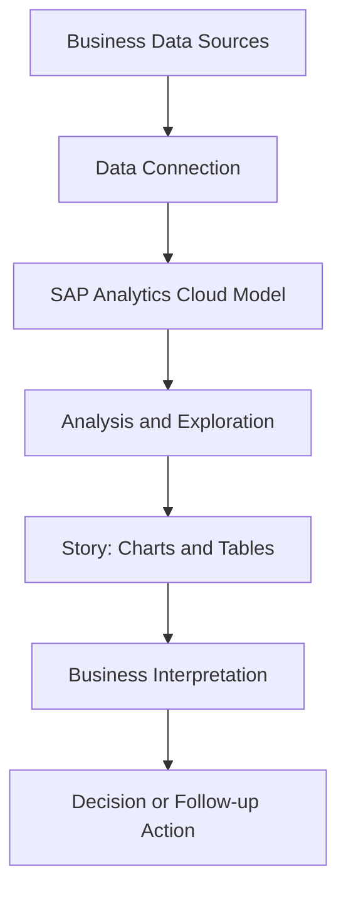
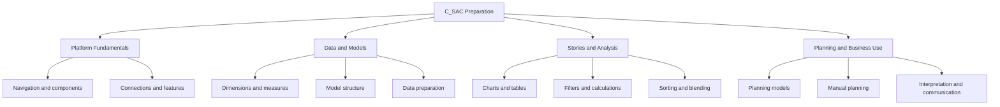
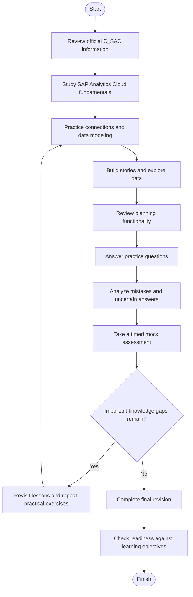
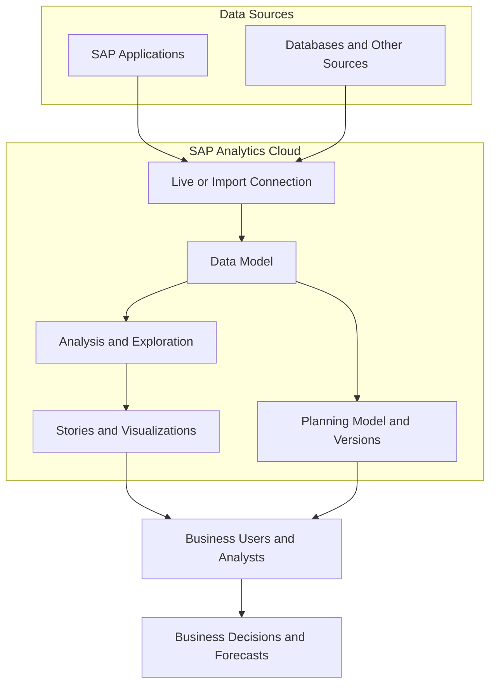
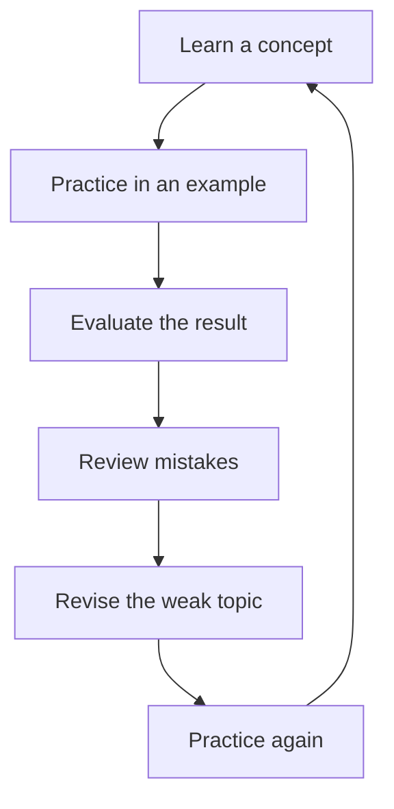
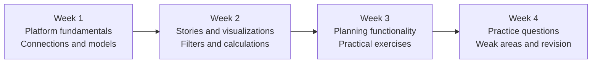

# SAP Analytics Cloud Data Analyst (C_SAC) — Study Guide

A practical study guide for the **SAP Certified – Data Analyst – SAP Analytics Cloud (C_SAC)** certification. This repository brings together SAP Analytics Cloud fundamentals, data modeling, analytics stories, data exploration, visualization, and planning concepts in one structured learning resource.

The goal is to help learners understand how data moves from a source into an analytical model, how that model supports meaningful visualizations, and how business users can use analytics and planning features to make informed decisions.

**Supplementary preparation resource:** [CertsGate — SAP C_SAC](https://certsgate.com/exams/sap/c_sac)

---

## Table of Contents

- [About the Certification](#about-the-certification)
- [Who Should Prepare?](#who-should-prepare)
- [Exam Information](#exam-information)
- [Core Knowledge Areas](#core-knowledge-areas)
- [How SAP Analytics Cloud Works](#how-sap-analytics-cloud-works)
- [Conceptual Skills Map](#conceptual-skills-map)
- [Preparation Flowchart](#preparation-flowchart)
- [Analytics Architecture Diagram](#analytics-architecture-diagram)
- [Study and Revision Cycle](#study-and-revision-cycle)
- [Step-by-Step C_SAC Preparation](#step-by-step-c_sac-preparation)
- [Suggested Study Roadmap](#suggested-study-roadmap)
- [Practice Questions and Mock Tests](#practice-questions-and-mock-tests)
- [Hands-On Exercises](#hands-on-exercises)
- [Common Preparation Mistakes](#common-preparation-mistakes)
- [Career Relevance](#career-relevance)
- [Frequently Asked Questions](#frequently-asked-questions)
- [Official and Additional Resources](#official-and-additional-resources)
- [About CertsGate](#about-certsgate)

---

## About the Certification

The **SAP Certified – Data Analyst – SAP Analytics Cloud** certification validates fundamental and core knowledge for the SAP Analytics Cloud Data Analyst profile. SAP describes it as demonstrating the knowledge and technical skills needed to participate as a member of a project team.

SAP Analytics Cloud is a cloud-based solution for business intelligence and planning. It enables users to connect to data, work with analytical models, create stories and visualizations, explore business performance, and carry out planning activities.

For example, an analyst might connect sales data to a model, create a story showing revenue by region, identify a change in performance, and share the results with business stakeholders. A planning user might use related functionality to enter forecast values and compare planned performance with actual results.

This study guide focuses on the knowledge and practical reasoning that help learners understand those workflows.

**Official certification page:**  
https://learning.sap.com/certifications/sap-certified-associate-data-analyst-sap-analytics-cloud-1

## Who Should Prepare?

This C_SAC study guide is suitable for:

- Aspiring data analysts who want to learn SAP Analytics Cloud.
- Business intelligence professionals working with dashboards and reports.
- SAP consultants involved in analytics or planning projects.
- Business users who need to interpret data and communicate findings.
- Professionals building foundational knowledge of SAP's analytics tools.

The official SAP learning journey lists no prerequisites. Familiarity with spreadsheets, business reporting, data dimensions, and basic analytical concepts can still make the learning process easier.

---

## Exam Information

The following details are listed on SAP's certification page reviewed for this guide.

| Item | Information |
|---|---|
| Certification | SAP Certified – Data Analyst – SAP Analytics Cloud |
| Exam code | C_SAC |
| Provider | SAP |
| Assessment type | Scenario Based |
| Duration | 2 hours |
| Published pass score | 60% |
| Recommended learning | Becoming a Certified Data Analyst in SAP Analytics Cloud |
| Core role | Data Analyst |

CertsGate lists the version as `C_SAC_2601`, while SAP's certification page identifies the exam as `C_SAC`. Verify the currently available certification version and assessment instructions with SAP before scheduling your assessment.

**Official source:** [SAP C_SAC certification](https://learning.sap.com/certifications/sap-certified-associate-data-analyst-sap-analytics-cloud-1)

SAP describes the assessment as scenario-based. In addition to learning terminology, prepare to interpret situations, choose appropriate analytical approaches, and explain why a particular action makes sense.

The official page should be checked for current registration requirements, subscription details, technical readiness, available attempts, and assessment policies.

---

## Core Knowledge Areas

SAP's learning journey highlights navigation, data modeling, stories, data exploration, and planning. Use the following table as a practical study checklist.

This is an **independent learning overview**, not an official exam-domain list or a representation of exam weightings.

| Knowledge area | What to understand |
|---|---|
| SAP Analytics Cloud fundamentals | Interface, components, available features, and common workflows |
| Data sources and connections | How data is made available for analysis |
| Data modeling | Dimensions, measures, model structure, and data preparation |
| Stories and visualizations | Charts, tables, filters, formatting, and presenting findings |
| Data exploration | Sorting, filtering, calculations, blending, and analytical comparisons |
| Planning | Planning models, versions, input, and basic planning workflows |
| Business interpretation | Translating analytical results into understandable findings |
| Collaboration | Sharing insights and communicating information with other users |

For each topic, aim to understand both the feature and the problem it solves. Knowing how to apply a filter is useful; knowing when a filter improves a business analysis is more valuable.

### Official learning objectives to work toward

Based on SAP's published learning journey, learners should be able to:

- Navigate SAP Analytics Cloud and distinguish its features and components.
- Design and present stories.
- Format, filter, calculate, explore, blend, and sort data.
- Perform manual planning and work with advanced planning functionality.

Refer to the official learning journey for the full course structure and updated learning content:

[Becoming a Certified Data Analyst in SAP Analytics Cloud](https://learning.sap.com/learning-journeys/becoming-a-certified-data-analyst-in-sap-analytics-cloud)

---

## How SAP Analytics Cloud Works

A typical analytics workflow begins with business data and ends with an insight that a user can interpret or act on.

For example, sales transactions might come from an enterprise system. Once the data is available through an appropriate connection, the analyst works with a model and builds a story that communicates trends, comparisons, or exceptions.

The exact configuration depends on the source system, connection type, data model, permissions, and intended use.

### Example workflow

This is a simplified conceptual workflow. Specific SAP Analytics Cloud implementations may use different connection types, modeling approaches, and data flows.

---

## Conceptual Skills Map

SAP's public certification information and learning journey provide learning topics, but the reviewed sources do not publish a complete percentage-weighted exam-domain breakdown. The diagram below organizes study areas without assigning numerical weights.

Use this map to organize revision. It is not an official exam blueprint, and the branches should not be interpreted as equally weighted exam sections.

---

## Preparation Flowchart

A reliable C_SAC preparation process combines official learning, practical exploration, question practice, and review of weak areas.

The decision point is important. If you can answer a question but cannot explain why the answer is appropriate, revisit the concept before moving on.

---

## Analytics Architecture Diagram

The diagram below illustrates a common conceptual relationship between data sources, SAP Analytics Cloud, analytical stories, and planning. It is a learning aid, not a prescribed deployment architecture.

### Important concepts

- **Live connections:** Data is accessed from the connected source, subject to the capabilities and configuration of that connection.
- **Import connections:** Data is imported into SAP Analytics Cloud, where the applicable modeling and refresh approach determines how it is maintained.
- **Models:** Organize data so that it can be analyzed consistently.
- **Stories:** Present information through charts, tables, filters, and other analytical elements.
- **Planning:** Supports planning activities such as entering values, working with versions, and comparing planned results.

Do not assume that every data source supports every connection mode. Learn the relevant capabilities and limitations from the official documentation for the systems involved.

For product documentation, use the [SAP Analytics Cloud Help Portal](https://help.sap.com/docs/SAP_ANALYTICS_CLOUD).

---

## Study and Revision Cycle

C_SAC preparation should be iterative. Learn a feature, use it, evaluate the result, review mistakes, and repeat the exercise until you understand the reasoning behind your actions.

This cycle works especially well for data modeling and story design. Repeating a task helps you recognize how a change in the model, filter, calculation, or visualization affects the resulting analysis.

---

## Step-by-Step C_SAC Preparation

### Step 1: Review the official certification page

Start with the [SAP C_SAC certification page](https://learning.sap.com/certifications/sap-certified-associate-data-analyst-sap-analytics-cloud-1).

Confirm the current exam code, assessment duration, pass score, recommended learning path, and applicable assessment requirements.

### Step 2: Complete the introductory course

SAP provides the beginner course [Exploring SAP Analytics Cloud](https://learning.sap.com/courses/exploring-sap-analytics-cloud).

The course introduces the platform, data sources and connections, modeling, stories, planning, augmented analytics, and collaboration features. SAP lists the course at approximately 4 hours and 57 minutes; course content and availability may change.

Work through the lessons in sequence. Take notes on unfamiliar terminology and identify which features you need to practice.

### Step 3: Understand data sources and models

Study how data becomes available for analysis. Learn the purpose of a model, how dimensions and measures differ, and how model structure affects the results users see.

Try creating or reviewing a small model using sample business data. Check whether the data types, measures, dimensions, and relationships make sense for the questions you want to answer.

### Step 4: Practice stories and visualizations

A story should make business information easier to understand, not simply display as many charts as possible.

Practice creating charts and tables, applying filters, changing formatting, and arranging content so that the main finding is clear. Explore how sorting, calculations, and data blending affect the analysis.

SAP's [Designing Stories in SAP Analytics Cloud](https://learning.sap.com/courses/designing-stories-in-sap-analytics-cloud) course provides additional instruction on building and presenting stories.

### Step 5: Study planning functionality

Learn the basics of planning models, versions, manual input, and comparing planning data. Understand the difference between reviewing historical results and entering values for a plan or forecast.

For deeper practice, consult SAP's [Performing Manual Planning with SAP Analytics Cloud](https://learning.sap.com/courses/performing-manual-planning-with-sap-analytics-cloud) course.

### Step 6: Practice analytical reasoning

For each scenario, ask:

- What business question needs to be answered?
- Which data or model supports the analysis?
- What visualization best communicates the result?
- Which filters or calculations are needed?
- What limitations might affect the conclusion?
- How should the result be explained to a stakeholder?

This approach builds the practical reasoning needed to work with analytical scenarios.

### Step 7: Use practice questions as a knowledge check

Answer questions after studying the related concepts. When an answer is incorrect or uncertain, revisit the official learning material and try a similar exercise.

You can also explore [CertsGate's C_SAC preparation page](https://certsgate.com/exams/sap/c_sac) for supplementary study and practice resources. Treat third-party material as an additional knowledge check rather than a substitute for official SAP content.

### Step 8: Assess readiness

Complete a timed practice session, review your results by topic, and return to areas that need improvement.

You should be able to explain why a model, chart, filter, calculation, or planning action is appropriate for a given business scenario. Practice scores can help measure progress, but no score guarantees a particular exam outcome.

---

## Suggested Study Roadmap

The following four-week roadmap is an independent planning suggestion, not an official SAP requirement. Adjust it to your experience and available study time.

| Week | Focus | Suggested output |
|---|---|---|
| 1 | Platform navigation, connections, and modeling | Notes explaining models, dimensions, and measures |
| 2 | Stories, visualizations, and exploration | A sample story with charts, tables, and filters |
| 3 | Planning concepts and business scenarios | A small planning exercise and scenario notes |
| 4 | Practice questions, mock assessment, and revision | A weak-area checklist and final review notes |

A useful daily routine is to study one topic, apply it in an exercise, answer a few practice questions, and record what still feels unclear.

---

## Practice Questions and Mock Tests

Practice questions help identify gaps, but reviewing the reasoning behind each answer is what turns practice into learning.

Use this process:

1. **Answer:** Choose the response that best addresses the scenario.
2. **Explain:** State why it is suitable.
3. **Compare:** Identify why alternative answers are less appropriate.
4. **Map:** Connect the mistake to a learning topic.
5. **Revise:** Review the relevant official lesson or documentation.
6. **Retry:** Apply the concept to a different example.

### Original practice scenarios

The following questions are original educational examples created for this repository. They are not official SAP exam questions.

**Question 1: Choosing a visualization**

An analyst needs to compare monthly sales performance across several regions. Which approach is most appropriate as a starting point?

- A. Choose a chart without checking the data.
- B. Select a suitable comparison chart, confirm the measure and time dimension, and organize the results for clear regional comparison.
- C. Remove the time dimension to avoid showing trends.
- D. Use unrelated metrics on the same chart to increase the amount of information.

**Suggested answer: B.**

A useful visualization starts with the business question and the structure of the data. A suitable chart and clearly defined dimensions make comparisons easier to interpret.

**Question 2: Investigating an unexpected total**

A story displays a sales total that differs from the figure expected by the business team. What should the analyst investigate first?

- A. Change the chart colors.
- B. Publish the story immediately.
- C. Check the model, selected measures, filters, aggregation, and underlying data.
- D. Remove the sales measure from the story.

**Suggested answer: C.**

The discrepancy may come from the data, model, aggregation, or filters. Checking these factors helps identify the cause before the analyst communicates a conclusion.

**Question 3: Filtering an analysis**

A report should show revenue for a single region without changing the underlying dataset. Which action is most directly relevant?

- A. Apply an appropriate filter to the analysis.
- B. Delete records from the source.
- C. Rebuild the entire model without checking the requirement.
- D. Replace the measure with a text label.

**Suggested answer: A.**

A filter can narrow the displayed analysis to the required region. Its scope and effect should be checked so that users understand what the results represent.

**Question 4: Planning and actual results**

A business user wants to compare a planned figure with an actual figure. What should the analyst consider?

- A. Whether the relevant planning data and versions are available and comparable.
- B. Whether the story has a decorative background.
- C. Whether all dimensions can be removed.
- D. Whether the planned figure should automatically replace actual data.

**Suggested answer: A.**

Meaningful comparison depends on the relevant data, planning context, and versions. The analyst should verify that the figures are comparable before drawing conclusions.

### How to use a mock test

- Complete the session without looking up answers.
- Use the current official assessment duration as a timing reference.
- Review incorrect answers and correct answers that involved guessing.
- Group mistakes by topic, such as modeling, stories, or planning.
- Revisit the relevant learning content and retry similar scenarios.

For supplementary practice, visit [CertsGate C_SAC preparation resources](https://certsgate.com/exams/sap/c_sac). Confirm that any third-party material is relevant to the certification version you intend to take.

---

## Hands-On Exercises

Practical work helps connect SAP Analytics Cloud terminology to real analytical tasks. Use a permitted training environment if one is available to you, or prepare sample data and design the expected analysis before working in the product.

### Exercise 1: Analyze sales by region

Create or review a sample dataset with fields such as date, region, product, units sold, and revenue.

Tasks:

- Identify dimensions and measures.
- Compare revenue across regions.
- Filter the analysis to a selected period.
- Sort the results to identify high- and low-performing regions.
- Explain one finding in plain language.

**Learning goal:** Understand how data structure, filters, sorting, and visualization work together.

### Exercise 2: Build an analytical story

Create a story outline containing:

- A summary of overall performance.
- A chart comparing revenue across regions.
- A table showing selected product details.
- A filter for time period or region.
- A short explanation of the main business finding.

Think about which information a manager needs first and which details belong in a supporting view.

### Exercise 3: Investigate a reporting discrepancy

Imagine that two users report different totals for the same business measure.

Write down the checks you would perform:

1. Confirm that both users are examining the same period and scope.
2. Check filters and selected dimensions.
3. Verify the measure and aggregation.
4. Review the model and source data.
5. Document the explanation and any required correction.

**Learning goal:** Develop a repeatable approach to investigating analytical inconsistencies.

### Exercise 4: Explore a planning scenario

Using a suitable training environment or a written example, compare actual results with a planned version.

Consider:

- Which dimensions identify the relevant business unit and period?
- Which versions represent actual and planned values?
- What changes are needed to compare the figures correctly?
- How should the results be presented to stakeholders?

**Learning goal:** Understand the relationship between planning data, versions, and business interpretation.

### Exercise 5: Explain an insight to a stakeholder

Write a short summary of an analytical result without relying on technical jargon. Include what changed, where the change occurred, what evidence supports the observation, and what should be investigated next.

**Learning goal:** Connect analytical work with clear business communication.

---

## Common Preparation Mistakes

### Memorizing features without understanding their purpose

Learn why models, dimensions, measures, filters, and visualizations are used. Feature recognition alone does not develop analytical judgment.

### Skipping data modeling

A polished story can still be misleading if the underlying model or aggregation is incorrect. Understand the data before focusing on presentation.

### Choosing charts before defining the question

Start with the business question and determine which comparison or trend needs to be communicated. Then select a suitable visualization.

### Ignoring filters and calculations

Filters and calculations can change the meaning of a result. Check their scope and logic when interpreting a story.

### Treating planning as ordinary reporting

Planning involves additional concepts such as planning models, versions, and input. Study how these concepts support planning tasks.

### Practicing without reviewing mistakes

Keep a short record of the question, the concept you missed, the reason your answer was weak, and the material you need to revisit.

### Relying on practice material alone

Use SAP's learning journey and documentation as your primary sources. Third-party questions can support revision but should not replace learning the product concepts.

---

## Career Relevance

SAP Analytics Cloud skills are relevant to business intelligence, reporting, planning, and analytics-related work.

The concepts in this guide can help learners build a foundation for tasks such as:

- Preparing and interpreting business data.
- Supporting dashboards and management reports.
- Creating analytical stories and visualizations.
- Investigating unexpected results.
- Supporting business planning and forecast discussions.
- Explaining findings to technical and non-technical stakeholders.

Certification may help demonstrate knowledge of SAP Analytics Cloud, but employment outcomes depend on practical experience, broader analytical skills, role requirements, and employer needs.

---

## Frequently Asked Questions

### What is the SAP C_SAC certification?

It is the SAP Certified – Data Analyst – SAP Analytics Cloud certification. SAP describes it as validating the fundamental and core knowledge needed for the SAP Analytics Cloud Data Analyst profile.

### How long is the C_SAC assessment?

SAP's certification page lists the assessment duration as **2 hours**. Confirm the current details on the official page before taking the assessment.

### What is the published passing score?

The SAP certification page reviewed for this guide lists a **60% pass score**. Verify the current requirement directly with SAP because certification information can change.

### Is the C_SAC assessment scenario-based?

Yes. SAP currently identifies the assessment type as scenario-based. Practice interpreting business situations and explaining why a particular analytical approach is suitable.

### What should I study for C_SAC?

Start with SAP Analytics Cloud fundamentals, data connections, modeling, stories, visualization, data exploration, and planning. Follow the current official learning journey for the recommended sequence.

### Do I need previous SAP Analytics Cloud experience?

SAP's recommended learning journey lists no prerequisites. Practical exposure can still help you understand the interface and apply concepts more confidently.

### Where can I find official C_SAC learning materials?

Begin with the [Becoming a Certified Data Analyst in SAP Analytics Cloud](https://learning.sap.com/learning-journeys/becoming-a-certified-data-analyst-in-sap-analytics-cloud) learning journey and the [Exploring SAP Analytics Cloud](https://learning.sap.com/courses/exploring-sap-analytics-cloud) course.

### Are the practice questions in this repository official SAP questions?

No. They are original educational examples intended to help learners apply concepts. They are not represented as official or actual exam questions.

### How can I assess whether I am ready?

You should be able to explain key platform concepts, understand the relationship between data and models, design a clear analytical story, interpret filters and calculations, and discuss basic planning workflows. Use practice results to identify gaps, not as a guarantee of an exam outcome.

---

## Official and Additional Resources

The resources below provide a starting point for studying SAP Analytics Cloud.

| Resource | How it helps |
|---|---|
| [SAP C_SAC Certification](https://learning.sap.com/certifications/sap-certified-associate-data-analyst-sap-analytics-cloud-1) | Current certification details, assessment information, and preparation guidance |
| [Becoming a Certified Data Analyst in SAP Analytics Cloud](https://learning.sap.com/learning-journeys/becoming-a-certified-data-analyst-in-sap-analytics-cloud) | Learning journey covering models, stories, data exploration, and planning |
| [Exploring SAP Analytics Cloud](https://learning.sap.com/courses/exploring-sap-analytics-cloud) | Beginner course covering the platform, connections, modeling, stories, planning, and collaboration |
| [Designing Stories in SAP Analytics Cloud](https://learning.sap.com/courses/designing-stories-in-sap-analytics-cloud) | Story design, formatting, filtering, calculations, exploration, and presentation |
| [Performing Manual Planning with SAP Analytics Cloud](https://learning.sap.com/courses/performing-manual-planning-with-sap-analytics-cloud) | Manual planning, versions, planning models, and planning workflows |
| [SAP Analytics Cloud Help Portal](https://help.sap.com/docs/SAP_ANALYTICS_CLOUD) | Product documentation and technical guidance |
| [SAP Learning](https://learning.sap.com/) | Additional SAP courses and learning journeys |
| [CertsGate C_SAC Preparation](https://certsgate.com/exams/sap/c_sac) | Independent supplementary preparation resources |

SAP may update course content, product features, and certification requirements. Check the official sources for the current version and available learning material.

---

## About CertsGate

[CertsGate](https://certsgate.com/) is an independent IT certification preparation resource covering certification tracks from multiple technology providers.

For learners preparing for C_SAC, the [SAP Analytics Cloud Data Analyst page](https://certsgate.com/exams/sap/c_sac) can serve as a supplementary place to explore available study and practice resources.

A useful routine is to learn a concept from SAP's materials, apply it in a practical exercise, answer related practice questions, and revisit any mistakes. This helps keep question practice connected to actual understanding of the platform.

---
